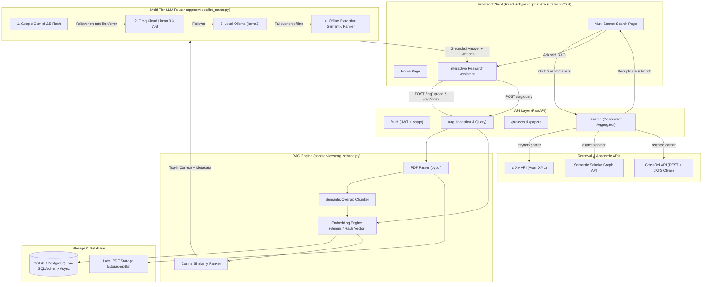
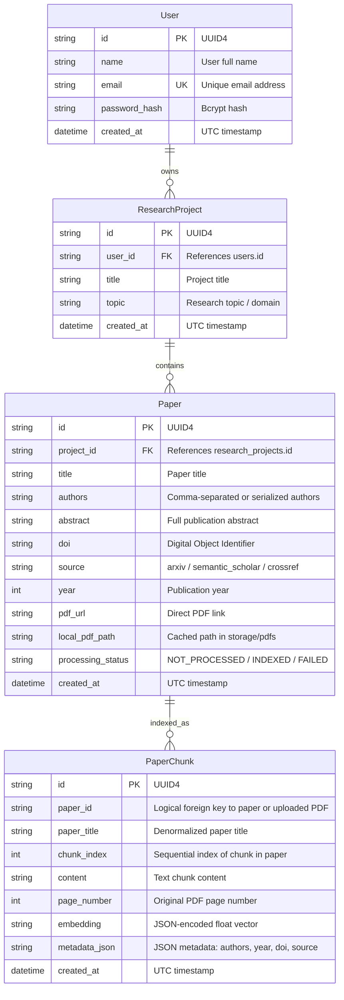

# Intelligent Academic Research Assistant (ARA) — Project Documentation

> **Comprehensive Technical Architecture, System Blueprint, and Feature Reference**  
> *Developed for Minor Project II based on System Requirements Specification (SRS) & Architecture Blueprint*  
> **Current Milestone**: Phase 1 (Foundations), Phase 2 (Multi-Source Retrieval), and Phase 3 (RAG Core & Multi-Tier LLM Router) **Complete & Integrated** (~55% Overall Progress).

---

## 1. Executive Summary

The **Intelligent Academic Research Assistant (ARA)** is an AI-powered academic discovery, literature analysis, and synthesis platform designed to streamline academic workflows for students, researchers, and scientists. 

Traditional academic literature search requires manual cross-referencing across fragmented repositories, reading dozens of multi-page PDFs, and tracking citations manually. ARA addresses these challenges by combining:
1. **Multi-Source Concurrent Literature Retrieval** across arXiv, Semantic Scholar, and CrossRef with real-time deduplication and metadata enrichment.
2. **Domain-Specific Retrieval-Augmented Generation (RAG)** that parses PDF research papers, partitions them into semantic chunks with overlap, computes vector embeddings, and performs cosine similarity search.
3. **Resilient Multi-Tier LLM Router** featuring automatic cascading failover (`Google Gemini 2.5 Flash` &rarr; `Groq Cloud Llama 3.3 70B` &rarr; `Local Ollama Llama 3` &rarr; `Offline Extractive Semantic Ranker`), ensuring **zero downtime** even without active cloud API keys or internet access.
4. **Interactive Research Workspace** offering grounded inline citations, snippet verification, direct PDF ingestion, and five specialized academic query modes (Q&A, Executive Summary, Methodology Analysis, Research Gaps, and BibTeX Generation).

---

## 2. Core Capabilities & Highlights

| Feature | Description | Status |
|---|---|---|
| **Federated Paper Retrieval** | Concurrent fan-out search across arXiv, Semantic Scholar, and CrossRef with polite rate-limiting and custom User-Agent headers. | ✅ Production Ready |
| **Two-Stage Deduplication** | Merges duplicate publications by normalized DOI (primary) and fuzzy title matching (secondary), preserving the richest abstract and direct PDF links. | ✅ Production Ready |
| **PDF Ingestion & Extraction** | Extracts text page-by-page from local files, remote URLs, or direct user file uploads via `pypdf`. | ✅ Production Ready |
| **Semantic Chunking** | Recursive sentence- and paragraph-aware chunking (800 characters with 150-character overlap) to preserve scientific context across page boundaries. | ✅ Production Ready |
| **Dual Embedding Strategy** | High-dimensional embeddings via Google Gemini `text-embedding-004` with an automatic fallback to deterministic normalized feature hashing vectors (256-dim). | ✅ Production Ready |
| **Multi-Tier LLM Router** | Automatic cascading failover across Gemini, Groq, local Ollama, and offline extractive summarization. | ✅ Production Ready |
| **Grounded Citations** | Every AI response is backed by source cards displaying paper title, authors, publication year, page numbers, chunk index, and cosine similarity score. | ✅ Production Ready |
| **Specialized Research Prompts** | Instant one-click query modes: Comprehensive Q&A, Executive Summary, Methodology Deep Dive, Research Gaps, and BibTeX/APA generation. | ✅ Production Ready |
| **Project & Paper Management** | User authentication with JWT and bcrypt, with support for saved research projects and downloaded PDF disk caching. | ✅ Production Ready |

---

## 3. System Architecture & Data Flow

### 3.1 High-Level Architecture Diagram



### 3.2 End-to-End Workflow

1. **Literature Discovery**:
   - The user inputs a query (e.g., *"retrieval augmented generation"*) on `Search.tsx`.
   - The backend `search.py` dispatches concurrent asynchronous requests via `asyncio.gather` to arXiv, Semantic Scholar, and CrossRef.
   - Results are unified and de-duplicated: papers sharing identical DOIs or normalized titles are merged into a single entry preserving the richest abstract and direct PDF link.
2. **Ingestion & Indexing**:
   - The user clicks **"Ask with RAG"** on a search card or uploads a PDF directly in `Assistant.tsx`.
   - The backend checks for a local PDF or downloads it from the paper's URL. If no PDF is accessible, the title and abstract are indexed.
   - Text is split into overlapping chunks ($800$ characters with $150$ characters overlap) to ensure boundary continuity.
   - Vector embeddings are computed and stored in the database alongside paper metadata.
3. **Synthesis & Grounded Reasoning**:
   - The user submits an inquiry and selects a research mode (e.g., *Methodology Analysis* or *Research Gaps*).
   - The query is embedded, and the most relevant chunks across selected papers are retrieved via cosine similarity ranking.
   - The prompt context is formatted with numbered citations (`[1]`, `[2]`).
   - The `LLMRouter` cascades through available model tiers, generates the synthesized response, and returns both the answer and clickable citation cards with exact similarity scores and snippets.

---

## 4. Technology Stack Matrix

| Layer | Component | Technology / Library | Rationale |
|---|---|---|---|
| **Backend** | Framework | **FastAPI** (Python 3.11+) | High-performance asynchronous execution, automatic OpenAPI documentation, clean dependency injection. |
| **Backend** | ORM & DB Access | **SQLAlchemy 2.0 (Async)** + **aiosqlite** | Fully asynchronous database queries; easily swappable to PostgreSQL (`asyncpg`) without code changes. |
| **Backend** | Data Validation | **Pydantic v2** | Strong schema enforcement, automatic JSON serialization, and environment configuration management. |
| **Backend** | Authentication | **python-jose** + **passlib (bcrypt)** | Stateless JWT authentication with secure password salting and hashing. |
| **Academic Sources** | Paper Retrieval | `httpx`, `xml.etree.ElementTree`, `re` | Asynchronous HTTP queries to arXiv, Semantic Scholar, and CrossRef APIs with JATS XML cleaning. |
| **RAG Pipeline** | Document Parsing | **pypdf** | Native PDF text and page extraction without heavy native system dependencies. |
| **RAG Pipeline** | Embeddings | **Google GenAI (`text-embedding-004`)** + Normalized Feature Hashing Fallback | High-accuracy embeddings with a zero-dependency offline backup vector algorithm. |
| **LLM Router** | Model Orchestration | **Google Gemini 2.5 Flash**, **Groq (Llama 3.3 70B)**, **Ollama**, Extractive Ranker | Multi-provider resiliency preventing single-point-of-failure or API quota exhaustion. |
| **Frontend** | Core Framework | **React 18** + **TypeScript** | Type-safe single-page application with modular component hierarchy. |
| **Frontend** | Tooling & Bundler | **Vite** | Ultra-fast Hot Module Replacement (HMR) and optimized production builds. |
| **Frontend** | Styling & UI | **TailwindCSS** + Lucide-style SVG icons | Clean, modern, responsive academic dashboard styling. |
| **Frontend** | HTTP Client | **Axios** | Typed client with interceptor support for authorization headers. |
| **Infrastructure** | Containerization | **Docker** & **Docker Compose** | Reproducible multi-container local and staging environment (`ara-backend` + `ara-frontend`). |

---

## 5. Database Schema & Data Models

The database models are implemented using SQLAlchemy Declarative Mapping with async support.



---

## 6. API Reference

All backend endpoints are prefixed by logical domain groups and documented interactively at `/docs`.

### 6.1 System & Health
- `GET /` &mdash; Returns application status and link to interactive API documentation.
- `GET /health` &mdash; Healthcheck endpoint returning `{"status": "ok", "app": "..."}`.

### 6.2 Authentication (`/auth`)
- `POST /auth/register` &mdash; Creates a new user profile.
  - *Request*: `{"name": "...", "email": "...", "password": "..."}`
  - *Response*: `{"id": "...", "name": "...", "email": "..."}`
- `POST /auth/login` &mdash; Validates credentials and returns JWT bearer token.
  - *Request*: `{"email": "...", "password": "..."}`
  - *Response*: `{"access_token": "...", "token_type": "bearer"}`
- `GET /auth/me` &mdash; Returns the authenticated user's profile (`Bearer <token>` required).

### 6.3 Multi-Source Search (`/search`)
- `GET /search/papers?q={query}&max_results={int}` &mdash; Fans out concurrently to arXiv, Semantic Scholar, and CrossRef, merges duplicates, and returns unified results.
  - *Response*:
    ```json
    [
      {
        "title": "Retrieval-Augmented Generation for Knowledge-Intensive NLP Tasks",
        "authors": ["Patrick Lewis", "Ethan Perez", "Aleksandra Piktus"],
        "abstract": "Large pre-trained language models store factual knowledge in their parameters...",
        "doi": "10.48550/arXiv.2005.11401",
        "source": "arxiv/semanticscholar",
        "year": 2020,
        "pdf_url": "https://arxiv.org/pdf/2005.11401.pdf"
      }
    ]
    ```

### 6.4 Research Projects & Saved Papers (`/projects`, `/papers`)
- `POST /projects` &mdash; Creates a research workspace for an authenticated user.
- `GET /projects` &mdash; Lists all projects belonging to the authenticated user.
- `GET /projects/{id}` &mdash; Returns project metadata and associated saved papers.
- `DELETE /projects/{id}` &mdash; Deletes a project and its paper associations.
- `POST /projects/{id}/papers` &mdash; Saves a discovered paper into the project.
- `DELETE /projects/{id}/papers/{paper_id}` &mdash; Removes a saved paper from the project.
- `POST /papers/{id}/download` &mdash; Downloads and caches the paper's PDF to local disk (`/storage/pdfs`).

### 6.5 RAG Knowledge Base & Assistant (`/rag`)
- `POST /rag/index` &mdash; Ingests a paper from search metadata or remote PDF into the RAG vector store.
  - *Request*: `{"title": "...", "abstract": "...", "pdf_url": "...", "authors": [...], "year": 2024}`
  - *Response*: `{"paper_id": "...", "title": "...", "chunks_created": 14, "status": "indexed"}`
- `POST /rag/upload` &mdash; Multipart file upload for local PDF papers. Extracts pages, chunks content, generates embeddings, and saves the file.
- `POST /rag/query` &mdash; Queries indexed papers using semantic search and LLM synthesis.
  - *Request*:
    ```json
    {
      "query": "What are the core evaluation metrics used for retrieval quality?",
      "paper_ids": ["uuid-1", "uuid-2"],
      "top_k": 5,
      "mode": "methodology",
      "api_key": null
    }
    ```
  - *Response*:
    ```json
    {
      "answer": "The authors evaluate retrieval quality using MRR@10 and Recall@k...",
      "citations": [
        {
          "paper_title": "Dense Passage Retrieval for Open-Domain QA",
          "authors": ["Karpukhin et al."],
          "year": 2020,
          "page_number": 6,
          "chunk_index": 12,
          "snippet": "We evaluate retrieval using Top-20 and Top-100 retrieval accuracy...",
          "similarity_score": 0.8421
        }
      ],
      "mode_used": "methodology",
      "fallback_mode": false,
      "model_used": "gemini:gemini-2.5-flash"
    }
    ```
- `GET /rag/papers` &mdash; Lists all papers currently indexed in the RAG knowledge base with chunk counts.
- `DELETE /rag/papers/{paper_id}` &mdash; Deletes all chunks and vector data for a paper from the RAG store.

---

## 7. Deep-Dive: Core Technical Implementations

### 7.1 Concurrent Multi-Source Retrieval & Deduplication
The retrieval engine (`search.py`) executes an asynchronous fan-out across three academic repositories:
1. **arXiv**: Uses `arxiv_service.py` to fetch from `http://export.arxiv.org/api/query`, parsing Atom XML feed responses into normalized titles, authors, and PDF links.
2. **Semantic Scholar**: Queries the Graph API (`api.semanticscholar.org/graph/v1/paper/search`) requesting fields `title,authors,abstract,year,externalIds,openAccessPdf`.
3. **CrossRef**: Queries `api.crossref.org/works`, stripping JATS XML tags (`<jats:p>`, `<jats:italic>`) from abstracts and identifying open-access publisher PDF links.

**Two-Stage Deduplication Algorithm**:
- **Stage 1 (DOI matching)**: Primary matching against normalized DOI strings (`norm_doi = paper.doi.strip().lower()`).
- **Stage 2 (Title normalization)**: Secondary fuzzy matching for preprints or unassigned DOIs using alphanumeric lowercasing (`re.sub(r"[^\w\s]", "", title.lower()).strip()`).
- **Metadata Merging**: When duplicates are detected, the algorithm merges records by choosing the longer abstract, preferring existing PDF links, retaining full author lists, and concatenating source badges (e.g., `arxiv/semanticscholar`).

### 7.2 Semantic Chunking & Vector Math
The RAG pipeline (`rag_service.py`) handles text extraction and vector indexing:
- **PDF Extraction**: Text is extracted page-by-page using `pypdf.PdfReader`, preserving page indices for exact citation grounding.
- **Recursive Sentence Splitting**: Text is split on paragraph breaks and sentence endings (`(?<=[.\n])\s+`). Chunks are capped at $800$ characters with a $150$-character backward sliding overlap window.
- **Embedding Strategy**:
  - If a Gemini API key is configured, the system calls Google GenAI `text-embedding-004` to compute dense semantic embeddings.
  - If no API key is provided or the remote call fails, the system executes deterministic normalized feature hashing (`_hash_vector`) producing 256-dimensional unit vectors. This allows cosine similarity searches to proceed entirely offline.
- **Cosine Similarity Ranking**: Computes $\cos(\theta) = \frac{\mathbf{u} \cdot \mathbf{v}}{\|\mathbf{u}\|_2 \|\mathbf{v}\|_2}$ across all candidate chunks, sorting them in descending order and extracting the top-$k$ passages.

### 7.3 Zero-Downtime Multi-Tier LLM Router
The `LLMRouter` (`llm_router.py`) orchestrates synthesis requests through a cascading failover hierarchy:
```
[User Query + Grounded Context]
               │
               ▼
   ┌───────────────────────┐
   │ 1. Google Gemini      │ ── Success ──► Return Synthesized Answer
   │    gemini-2.5-flash   │
   └───────────────────────┘
               │ (Fails / Unconfigured / Rate Limit)
               ▼
   ┌───────────────────────┐
   │ 2. Groq Cloud         │ ── Success ──► Return Synthesized Answer
   │    llama-3.3-70b      │
   └───────────────────────┘
               │ (Fails / Unconfigured)
               ▼
   ┌───────────────────────┐
   │ 3. Local Ollama       │ ── Success ──► Return Synthesized Answer
   │    llama3 (port 11434)│
   └───────────────────────┘
               │ (Offline / Unreachable)
               ▼
   ┌───────────────────────────────────────────────┐
   │ 4. Semantic Extractive Ranker                 │
   │    Formats highest-scoring literature chunks  │ ──► Return Grounded Insights
   │    with similarity metrics & citations        │
   └───────────────────────────────────────────────┘
```

### 7.4 Specialized Academic Research Modes
The RAG engine supports five purpose-built modes through tailored system prompt injections:
1. **Q&A (`qa`)**: Comprehensive, factual academic answers grounded strictly in retrieved context with inline brackets (`[1]`, `[2]`).
2. **Executive Summary (`summarize`)**: High-level structured summary breaking down Core Objective, Methodology, Key Findings, and Scholarly Significance.
3. **Methodology Deep Dive (`methodology`)**: In-depth analysis of experimental design, benchmarks, datasets, model architectures, and evaluation metrics.
4. **Research Gaps & Limitations (`gaps`)**: Critical synthesis of author-stated constraints, potential biases, unaddressed edge cases, and future directions.
5. **Citation Generation (`bibtex`)**: Auto-generates ready-to-use BibTeX entries and APA-formatted citations from paper metadata.

---

## 8. Installation & Setup Guide

### 8.1 Prerequisites
- **Python**: Version 3.11 or higher
- **Node.js**: Version 18 or 20 LTS (`npm` included)
- **Docker & Docker Compose** *(optional, for containerized run)*
- **Git**

### 8.2 Environment Configuration
Copy the example environment template to `.env` at the repository root:

```bash
cp .env.example .env
```

Edit `.env` to configure your settings:
```ini
APP_NAME="Intelligent Academic Research Assistant"
ENV=development

# Database configuration (SQLite for local development)
DATABASE_URL=sqlite+aiosqlite:///./ara.db

# JWT Security
JWT_SECRET_KEY=generate-a-secure-random-secret-key-here
JWT_ALGORITHM=HS256
ACCESS_TOKEN_EXPIRE_MINUTES=1440

CORS_ORIGINS=["http://localhost:5173", "http://localhost:3000"]

# Optional Academic & AI API Keys (System works in offline/fallback mode without them)
SEMANTIC_SCHOLAR_API_KEY=
CROSSREF_MAILTO=researcher@example.com
GEMINI_API_KEY=
GROQ_API_KEY=

# Local Storage Paths
STORAGE_DIR=./storage/pdfs
CHROMA_DIR=./storage/chroma
```

### 8.3 Running with Docker Compose (Recommended)
Launch both the backend and frontend containers with a single command:

```bash
docker compose up --build
```
- **Backend API**: Accessible at `http://localhost:8000` (Docs at `http://localhost:8000/docs`)
- **Frontend Web UI**: Accessible at `http://localhost:5173`

### 8.4 Running Locally (Without Docker)

#### Step 1: Start the FastAPI Backend
```bash
# Navigate to backend directory
cd backend

# Create and activate virtual environment
python -m venv venv
# On Windows (cmd/PowerShell):
venv\Scripts\activate
# On Linux/macOS:
source venv/bin/activate

# Install dependencies
pip install -r requirements.txt

# Start development server
uvicorn app.main:app --reload --port 8000
```

#### Step 2: Start the React Frontend
```bash
# In a new terminal, navigate to frontend directory
cd frontend

# Install npm dependencies
npm install

# Start Vite dev server
npm run dev
```

Open your browser at `http://localhost:5173`.

---

## 9. Verification & Testing

Verify that core services are healthy and responding using `curl` or PowerShell:

```bash
# 1. Healthcheck
curl http://localhost:8000/health

# 2. Register a new user
curl -X POST http://localhost:8000/auth/register \
  -H "Content-Type: application/json" \
  -d '{"name":"Demo Researcher","email":"demo@academic.org","password":"password123"}'

# 3. Log in to acquire JWT token
curl -X POST http://localhost:8000/auth/login \
  -H "Content-Type: application/json" \
  -d '{"email":"demo@academic.org","password":"password123"}'

# 4. Multi-Source Search (arXiv + Semantic Scholar + CrossRef)
curl "http://localhost:8000/search/papers?q=transformers%20attention&max_results=3"

# 5. List currently indexed RAG papers
curl http://localhost:8000/rag/papers
```

---

## 10. Repository Directory Structure

```
Intelligent-Academic-Research-Assistant/
├── .env.example               # Environment variables template
├── docker-compose.yml         # Container configuration for backend + frontend
├── PROGRESS.md                # Development milestone tracker & resume point
├── PROJECT.md                 # Complete system documentation (this file)
├── README.md                  # Quickstart documentation
│
├── backend/
│   ├── Dockerfile             # Python 3.11 slim container build
│   ├── requirements.txt       # FastAPI, SQLAlchemy, pypdf, google-genai, etc.
│   ├── storage/               # Local disk storage for downloaded/uploaded PDFs
│   └── app/
│       ├── main.py            # FastAPI entrypoint, lifespan DB init, CORS
│       ├── api/
│       │   └── routes/
│       │       ├── auth.py     # User registration, login, profile (/auth)
│       │       ├── health.py   # System health probes (/health)
│       │       ├── paper.py    # Paper caching & PDF download (/papers)
│       │       ├── projects.py # User project workspaces (/projects)
│       │       ├── rag.py      # Ingestion, PDF upload, querying (/rag)
│       │       └── search.py   # Concurrent multi-source search (/search)
│       ├── core/
│       │   ├── config.py      # Pydantic Settings configuration
│       │   ├── deps.py        # JWT verification & DB session injection
│       │   └── security.py    # Password hashing and token generation
│       ├── db/
│       │   ├── base.py        # SQLAlchemy DeclarativeBase
│       │   └── session.py     # Async sessionmaker and engine
│       ├── models/
│       │   ├── paper_chunk.py # PaperChunk entity (embeddings & content)
│       │   ├── papers.py      # Paper entity (metadata, status, paths)
│       │   ├── research_project.py # ResearchProject entity
│       │   └── user.py        # User entity
│       ├── schemas/
│       │   ├── auth.py        # User & Token Pydantic models
│       │   ├── paper.py       # Paper search result schemas
│       │   ├── project.py     # Project creation schemas
│       │   └── rag.py         # RAG query, response, and citation schemas
│       └── services/
│           ├── arxiv_service.py           # arXiv API connector
│           ├── crossref_service.py        # CrossRef API connector
│           ├── llm_router.py              # Multi-tier LLM failover gateway
│           ├── pdf_service.py             # Asynchronous PDF downloader
│           ├── rag_service.py             # Chunking, embeddings, RAG pipeline
│           └── semantic_scholar_service.py # Semantic Scholar connector
│
└── frontend/
    ├── package.json           # Dependencies (React 18, Vite, TailwindCSS)
    ├── vite.config.ts         # Vite bundler configuration
    ├── tsconfig.json          # TypeScript compiler options
    └── src/
        ├── App.tsx            # Main application layout and routes
        ├── main.tsx           # React entrypoint
        ├── index.css          # Tailwind CSS directives
        ├── api/
        │   └── client.ts      # Axios API client & TypeScript interfaces
        └── pages/
            ├── Home.tsx       # Landing page & feature showcase
            ├── Search.tsx     # Multi-source literature search page
            └── Assistant.tsx  # Interactive RAG assistant & paper library
```

---

## 11. Alignment with SRS Minor Project II Specifications

| SRS Requirement | Description | Implementation in Codebase |
|---|---|---|
| **FR1: User Management** | User registration, login, and secure session management. | [backend/app/api/routes/auth.py](file:///backend/app/api/routes/auth.py), [backend/app/core/security.py](file:///backend/app/core/security.py) (JWT + bcrypt). |
| **FR2: Multi-Source Paper Retrieval** | Query external academic databases (arXiv, Semantic Scholar, CrossRef). | [backend/app/api/routes/search.py](file:///backend/app/api/routes/search.py), [backend/app/services/arxiv_service.py](file:///backend/app/services/arxiv_service.py), [backend/app/services/semantic_scholar_service.py](file:///backend/app/services/semantic_scholar_service.py), [backend/app/services/crossref_service.py](file:///backend/app/services/crossref_service.py). |
| **FR3: Automated PDF Ingestion** | Extract clean text from full-text PDFs and store structured metadata. | [backend/app/services/pdf_service.py](file:///backend/app/services/pdf_service.py), [backend/app/services/rag_service.py](file:///backend/app/services/rag_service.py) (`pypdf` page parser). |
| **FR4: Semantic Chunking & Vector Search** | Partition documents into context-preserving chunks with similarity ranking. | [backend/app/services/rag_service.py](file:///backend/app/services/rag_service.py) (800-char recursive chunking, Gemini/hash vector embeddings, cosine ranking). |
| **FR5: Grounded RAG Generation** | Generate accurate answers cited back to specific paper sections and pages. | [backend/app/services/rag_service.py](file:///backend/app/services/rag_service.py), [frontend/src/pages/Assistant.tsx](file:///frontend/src/pages/Assistant.tsx) (inline citations, snippet viewer). |
| **FR6: Failover LLM Routing** | Graceful multi-tier fallback ensuring uninterrupted synthesis. | [backend/app/services/llm_router.py](file:///backend/app/services/llm_router.py) (Gemini &rarr; Groq &rarr; Ollama &rarr; Extractive). |
| **FR7: Project Organization** | Save papers into named research projects. | [backend/app/api/routes/projects.py](file:///backend/app/api/routes/projects.py), [backend/app/models/research_project.py](file:///backend/app/models/research_project.py). |
| **NFR1: Performance & Concurrency** | Non-blocking I/O across external APIs and database queries. | Asynchronous `asyncio.gather`, async SQLAlchemy, FastAPI non-blocking event loop. |
| **NFR2: Resiliency** | Zero-crash fallback when API keys are absent or endpoints throttle. | Dual embedding fallback + extractive semantic synthesis mode in `rag_service.py`. |
| **NFR6: Database Portability** | Database layer agnostic between SQLite (dev) and PostgreSQL (prod). | SQLAlchemy ORM declarative models, configurable `DATABASE_URL`. |

---

## 12. Upcoming Roadmap & Next Phases

As documented in [PROGRESS.md](file:///PROGRESS.md), the system is scheduled for the following future enhancements:

### Phase 4: Advanced Analysis & Knowledge Synthesis
- **Topic Modeling & Keyword Clustering**: Cross-paper keyword extraction across collections of saved project papers.
- **Cross-Paper Comparison Matrix**: Automated generation of tabular comparisons evaluating methodologies, datasets, sample sizes, and empirical findings.
- **Literature Review Synthesis**: Automated multi-paper narrative generation highlighting agreements, contradictions, and emerging trends.

### Phase 5: Citation & Export Tools
- **Comprehensive Citation Export**: Automated export of references in BibTeX, APA, MLA, IEEE, and Chicago styles.
- **Report Exporter**: Compiling saved research findings and chat syntheses into downloadable Markdown and PDF research briefs.

### Phase 6: Production Hardening & Deployment
- **Background Worker Pipeline**: Offloading PDF processing to asynchronous workers (Celery or Redis Queue) for multi-hundred page documents.
- **Persistent Vector Database Option**: Seamless switch to dedicated ChromaDB or pgvector container.
- **Cloud CI/CD Pipeline**: GitHub Actions automated linting, test suite execution, and container registry publishing.
